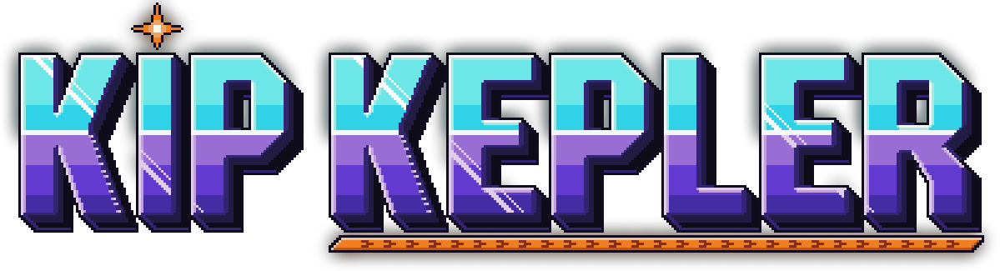
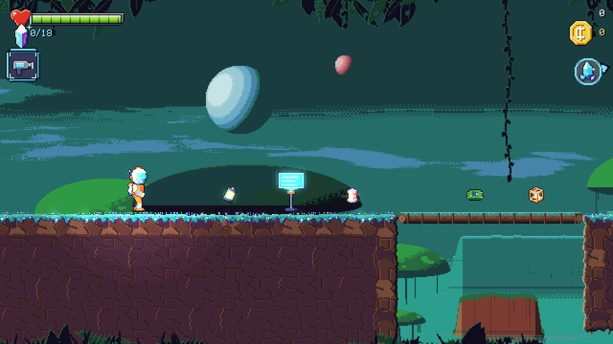
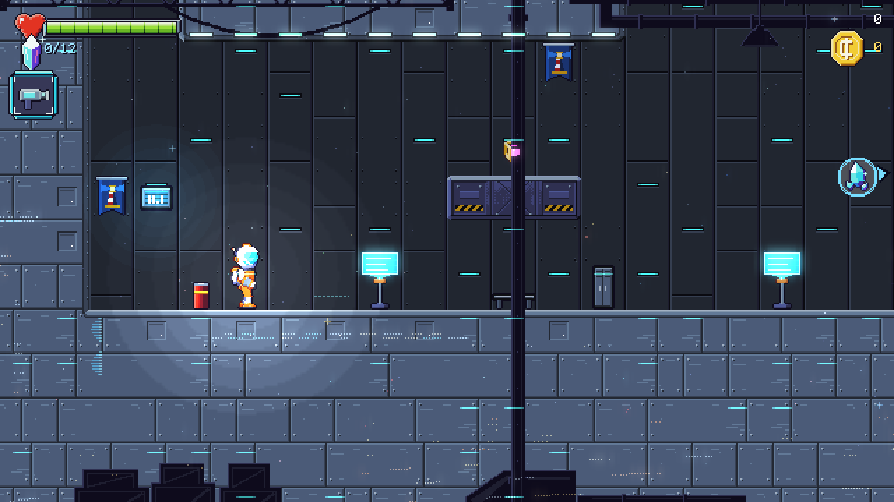
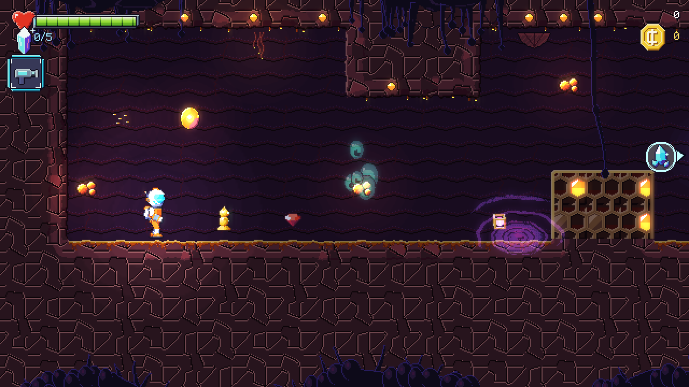
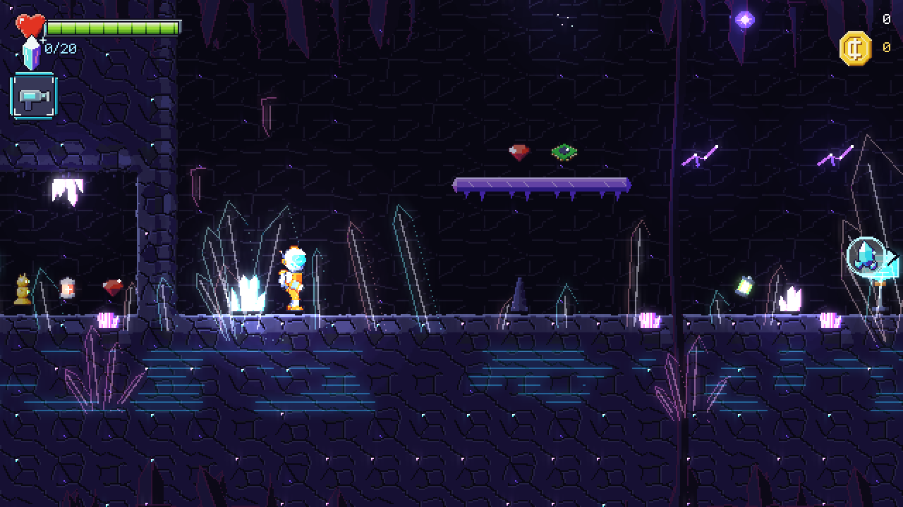
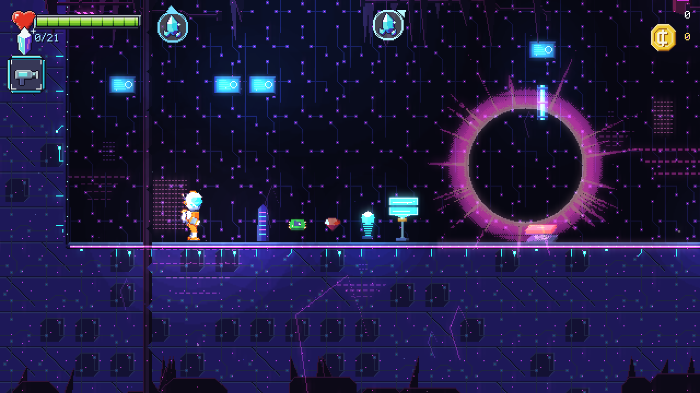
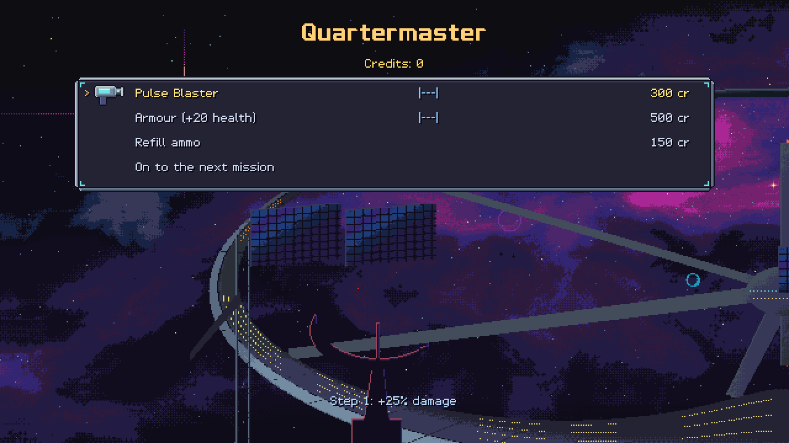
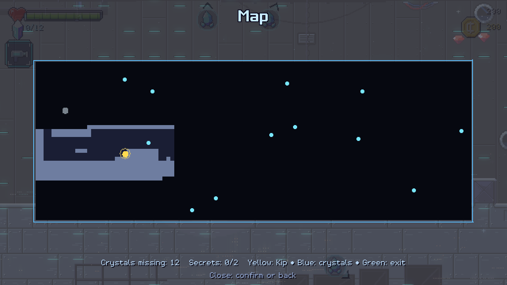

<h1 align="center"></h1>

<a href="https://reneweller-coding.itch.io/kip-kepler"><b>itch.io</b></a> ·
<a href="https://github.com/reneweller-coding/KipKepler/releases/latest"><b>Download</b></a> ·
<a href="LICENSE">AGPL-3.0</a>

A 2D action platformer in HD pixel art: Kip Kepler, the most junior cadet of the Beacon Corps, collects the shards
of four shattered beacons across four episodes of nine levels each -- crystals open the exit, key cards open doors,
switches move walls, fake walls hide secrets, and nine science-fiction weapons (bought up at the Quartermaster
between levels) deal with what lives there. Four bosses, a secret level per episode behind a hidden warp, the
Commodore's radio messages (spoken, German and English), 36 enemy kinds, logbook pages, a bestiary, medals, 40 awards, high scores,
New Game+, boss rush, time trials against your own ghost, daily and custom challenges, a pause map, a quick save in the
middle of a level, an assist mode, colour help, large text, a performance display and a level editor with a death
map. In the spirit of the early-90s shareware jump-and-runs, with its own world, levels and characters.

**Windows, Linux and the Steam Deck**, free and open source under the AGPL-3.0. Sprites, tiles, backgrounds, fonts
and sounds come from the game's own generators in `tools/`.

## Download

**[KipKepler-1.4.0-windows-x64.zip](https://github.com/reneweller-coding/KipKepler/releases/download/v1.4.0/KipKepler-1.4.0-windows-x64.zip)**
for Windows 10 and 11: unpack it anywhere and start `KipKepler.exe`, nothing to install. The
**[Linux archive](https://github.com/reneweller-coding/KipKepler/releases/download/v1.4.0/KipKepler-1.4.0-linux-x86_64.tar.gz)**
runs on any x86-64 distribution with glibc 2.35 or newer, SteamOS included (add `KipKepler` to Steam as a non-Steam
game). Both carry the player's readme (`README.txt`), the credits and the licence. The same packages are on
**[itch.io](https://reneweller-coding.itch.io/kip-kepler)**.

Requirements: a graphics card with OpenGL 3.3; a gamepad or the keyboard. The program is not code-signed: Windows'
SmartScreen may warn once ("More info", "Run anyway").

## Pictures

| | |
|:---:|:---:|
|  |  |
| A station of the Beacon Corps | Down in the caves |
|  |  |
| Crystal caverns | A warp gate in the last episode |
|  |  |
| The Quartermaster between levels | The pause map |

## Build

    .\build.ps1                 # Windows, MSVC: bin\msvc\KipKepler.exe and bin\msvc\KeplerTool.exe
    bash Deploy/build_linux.sh  # Linux / Steam Deck (WSL Ubuntu 22.04, GCC 12): dist/KipKepler-<v>-linux-x86_64.tar.gz
    .\Deploy\build_release.ps1  # both packages into dist/

C++20 on raylib 5.5 (its sources in third_party/raylib, no download). The game reads assets/ beside the program, else
the source tree's.

## Play

Keyboard: arrows/WASD run, Up aims up, Down + jump drops through platforms, Space/K/Z jump, Ctrl/J/X or the left
mouse button fire (hold the blaster to charge), L/C or the right mouse button alt fire, Q/E or the wheel switch
weapons, Esc/P pause, F11 or Alt+Enter fullscreen. Gamepad / Steam Deck: stick or d-pad, A jump, X/B/R2 fire, Y/L2
alt fire, LB/RB weapons, Start pause. On the Deck
(`SteamDeck=1`) the game runs fullscreen at 1280 x 800 (640 x 400 virtual pixels).

The saves and settings live in %APPDATA%\KipKepler (Linux: ~/.local/share/KipKepler).

## Layout

| Path | What |
|---|---|
| src/ | the game: App* (menus and flow; AppExtras: radio, medals, awards, logbook, rush, trials; AppMore: death records, ghosts, challenges, bestiary, pause map, quick save, performance display), World* (one level in play: hero, weapons, enemies, bosses, drawing), Physics (shared with the checker), Level (the file format), Checker, Screen (virtual pixels, light, bloom), Assets, Audio, Text, Save, Input |
| src/Editor* | the level editor (Extras > Level editor, 9 slots in the user folder; F1 shows its keys) |
| src/Bot.* | the autopilot (title demo, `--autotest`) on the checker's graph |
| src/tool/ | KeplerTool: `check` (reachability with the hero's own physics), `checkall`, `render` (CPU picture of a level) |
| docs/DESIGN.md | the contract between engine and generators: pixels, physics, the level format, sheets, tiles, sounds |
| docs/LEVELS.md | the plan of the 36 levels and the rules of level design |
| tools/ | the asset generators (Python): common/palette.py, sprites/ (a signed-distance-field baker: 3D parts -> pixel art), tiles/, backgrounds/, sfx/, fonts/, ui/, music/ (ACE-Step via the AudioGenerator), story/ (FLUX stills, pixelated), voices/ (Qwen3-TTS), sfx/make_ambience.py; gpu_queue.py runs the GPU jobs one after another when the GPU is free; autotest_all.py runs the autopilot over all 40 levels |
| assets/ | what the game reads: levels, sprites, tiles, bg, sound, music, fonts, ui, text |

## Test options

    KipKepler --level FILE | --episode N --stage M      play a level directly
    KipKepler --shot OUT.png [--at X,Y] [--warm S] [--hold rljfu] [--weapons]   a picture after S seconds (tiles for --at)
    KipKepler --menu title|main|episodes|levels|shop|options|difficulty|story|tally|pause|map|extras|awards|logbook|bestiary|challenge|radio --shot OUT.png
    KipKepler --autotest REPORT [--limit S] [--level FILE | --episode N]   the autopilot: no window, no sound, processor only
    KipKepler --demo --perf --seconds S                                    the demo with the performance log, hidden, ended after S
    KipKepler --help-look                                                  colour help and large text on (pictures; settings untouched)
    KipKepler --editor FILE                                                the level editor on a file
    KipKepler --mute --windowed --w W --h H --lang de|en --difficulty 0-2
    KeplerTool check LEVEL [overview.png] | checkall DIR | render LEVEL OUT.png [scale | x y w h]
    KeplerTool deaths LEVEL deaths.txt OUT.png [scale]                    a level with its knockouts (the death map)

## Credits and licence

[docs/CREDITS.txt](docs/CREDITS.txt) lists what KIP KEPLER is made from: raylib (zlib/libpng licence) and the tools
the music, the radio voice and the story stills were made with (ACE-Step 1.5, Qwen3-TTS, FLUX.2 [dev]); everything else
comes from the game's own generators.

KIP KEPLER is free software under the GNU Affero General Public License 3.0 ([LICENSE](LICENSE)): use it, change it,
pass it on, with the source of what you change.
